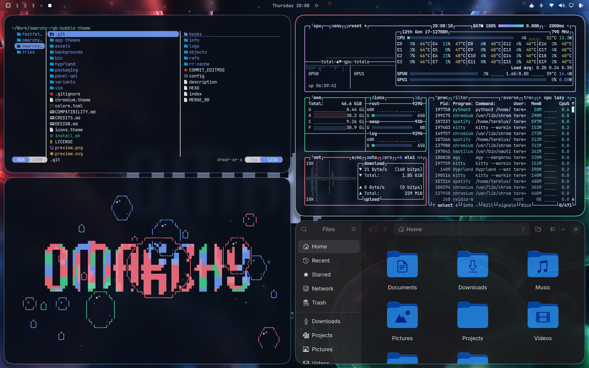
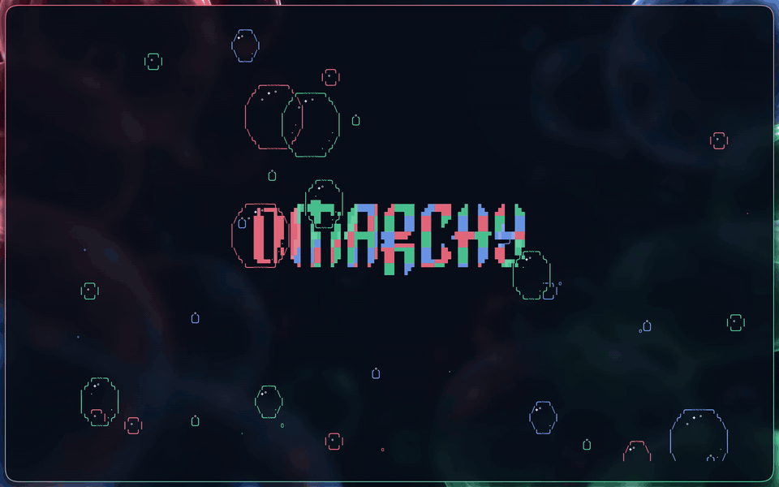

# RGB Bubble

A dark, translucent Omarchy theme by **@terelux** featuring midnight glass surfaces and vivid Coral Red, Mint Green, and Sky Blue accents.



> Independent community theme for [Omarchy](https://omarchy.org/).

---

## Installation

You can install **RGB Bubble** using Omarchy's standard theme installer, or run the **Full Experience** installer to also enable frosted-glass window rules, the top-bar vector bubble watermark, the Vim colorscheme, and the `cbubbles` terminal animation.

### 1. Standard Omarchy Theme Install

Copy the repository URL and select **Install > Style > Theme** from the Omarchy menu (`Super + Space`), or run:

```sh
omarchy theme install https://github.com/IlTere/omarchy-rgb-bubble-theme.git
```

#### What is included with `omarchy theme install`:
- **Midnight RGB App Palette (`colors.toml`):** Automatically generates matching themes for Alacritty, Foot, Ghostty, Kitty, Neovim, Helix, VS Code, `btop`, Obsidian, Hermes, Pi, and T3 Code.
- **Translucent Omarchy Shell (`shell.toml`):** 14% surface opacity (86% transparency) across the Omarchy top bar, launcher menu, notifications, clipboard, emoji picker, calendar/clock, audio, Bluetooth, display, Wi-Fi/network, battery/power, agent usage, weather, and reminder popups (and 40% opacity on authentication prompts for readability).
- **Browser & Icon Styling (`chromium.theme` & `icons.theme`):** Deep-navy Chromium frame and Yaru-blue icons.
- **3 Custom Wallpapers (`backgrounds/`):**
  1. `01-bubble-omarchy.webp` — Centered RGB glass-bubble Omarchy wordmark *(default)*
  2. `02-bubble-float.webp` — Floating RGB glass bubbles without wordmark
  3. `03-bubble-omarchy-pixel.webp` — Minimalist pixel-stepped Omarchy wordmark and pixel bubbles
- **Theme Switcher Thumbnail (`preview.png`):** High-resolution desktop preview in the Omarchy theme selector.

---

### 2. The Full Experience (Theme + All Extra Tweaks)

By design, [Omarchy's built-in repository-theme installer](https://github.com/omacom/omarchy/blob/quattro/manual/43-making-your-own-theme.md) stages palette and shell configuration files without executing custom scripts or loading `.lua` compositor modules.

To install **everything in one step** (the base theme plus all extra tweaks below):

```sh
curl -fsSL https://raw.githubusercontent.com/IlTere/omarchy-rgb-bubble-theme/main/install.sh | bash
```

#### What the Full Experience adds:
- **Hyprland Frosted-Glass Windows (`hyprland/rgb-bubble.lua`):**
  - **90% focused / 95% unfocused opacity** (10% / 5% transparency) for terminals, code editors (Vim, Neovim, Helix, VS Code), notes (Obsidian), file managers (Nautilus), and system utilities (`btop`, Spotify).
  - **100% opaque exclusions** for browsers, web apps, video/media players, games, image/document/PDF viewers, Office apps, Picture-in-Picture, and fullscreen windows.
  - **2-pass backdrop blur** (`size = 8`, `ignore_opacity = true`, `vibrancy = 0.28`) and rounded window corners (`rounding = 14`).
  - **100% theme-isolated:** Automatically disables itself when you switch to any other Omarchy theme.
- **Top-Bar Vector Bubble Watermark & Translucent OSD (`panel-qml/BubbleWatermark.qml`):**
  - Pure-vector QML RGB glass bubbles in the top bar and translucent OSD volume/brightness popups (strictly gated on `rgb-bubble` so other themes remain untouched).
- **`cbubbles` Terminal Animation CLI (`bin/cbubbles`):**
  - Interactive terminal RGB bubble & pixel-logo animation installed to `~/.local/bin/cbubbles`.
- **Dedicated Vim Colorscheme (`vim/colors/rgb-bubble.vim`):**
  - Installed to `~/.vim/colors/rgb-bubble.vim` (`:colorscheme rgb-bubble`).

---

### 3. Modular Tweaks (Install After `omarchy theme install`)

If you already installed the theme via `omarchy theme install https://github.com/IlTere/omarchy-rgb-bubble-theme.git`, the installer script is already inside `~/.config/omarchy/themes/rgb-bubble/install.sh`. You can enable all extra tweaks at once or pick individual ones:

```sh
# Install ALL extra tweaks (Hyprland glass + top-bar watermark + cbubbles + Vim colorscheme)
bash ~/.config/omarchy/themes/rgb-bubble/install.sh tweaks

# Or install individual tweaks:
bash ~/.config/omarchy/themes/rgb-bubble/install.sh hyprland   # Hyprland window opacity, blur & rounding only
bash ~/.config/omarchy/themes/rgb-bubble/install.sh panels     # Top-bar bubble watermark & OSD override only
bash ~/.config/omarchy/themes/rgb-bubble/install.sh cbubbles   # cbubbles terminal animation CLI only
bash ~/.config/omarchy/themes/rgb-bubble/install.sh vim        # Vim colorscheme only

# Cleanly remove all extra tweaks while keeping the base theme installed:
bash ~/.config/omarchy/themes/rgb-bubble/install.sh uninstall
```

*(Every subcommand also works remotely via `curl -fsSL https://raw.githubusercontent.com/IlTere/omarchy-rgb-bubble-theme/main/install.sh | bash -s -- <subcommand>`).*

---

## `cbubbles` — Terminal RGB Bubble Animation



`cbubbles` is a zero-dependency terminal animation bringing floating RGB glass bubbles and a pixel-art Omarchy centerpiece directly into your terminal.

```sh
cbubbles                  # Classic floating Red, Green & Blue bubbles
cbubbles -l               # Include the interactive centered Omarchy pixel logo
cbubbles -s 1.6 -d high   # Faster upward drift and higher bubble density
cbubbles -p neon -r pixel # Neon palette in pure pixel-block renderer
cbubbles help             # Full CLI reference & interactive keybindings
```

### Standalone `cbubbles` Package Installation
- **Via installer script:**
  ```sh
  curl -fsSL https://raw.githubusercontent.com/IlTere/omarchy-rgb-bubble-theme/main/install.sh | bash -s -- cbubbles
  ```
- **As an Arch Linux package (`pacman` / `makepkg`):**
  ```sh
  cd packaging && makepkg -si
  ```
- **As a Python CLI package (`pipx` or `uv`):**
  ```sh
  pipx install git+https://github.com/IlTere/omarchy-rgb-bubble-theme.git
  ```

---

## Repository Contents

- [`colors.toml`](colors.toml) — Dark palette used by Omarchy's generated app themes
- [`shell.toml`](shell.toml) — Translucent glass colors and RGB control states for Omarchy's shell
- [`chromium.theme`](chromium.theme) — Matching dark chrome color for Chromium-based browsers
- [`icons.theme`](icons.theme) — Yaru-blue icon theme variant
- [`backgrounds/`](backgrounds/) — 3 WebP RGB glass-bubble and pixel-art wallpapers
- [`preview.png`](preview.png) — Full-resolution desktop preview (`2560×1600`)
- [`assets/rgb-bubble.webp`](assets/rgb-bubble.webp) — `1200×675` (`<100 KB`) WebP thumbnail formatted for [omarchy.org/themes](https://omarchy.org/themes/)
- [`assets/cbubbles-demo.gif`](assets/cbubbles-demo.gif) — Animated GIF demo of `cbubbles`
- [`install.sh`](install.sh) — Full Experience and modular tweak installer/uninstaller
- [`hyprland/rgb-bubble.lua`](hyprland/rgb-bubble.lua) — Theme-isolated window opacity, rounded corners, and backdrop blur
- [`panel-qml/BubbleWatermark.qml`](panel-qml/BubbleWatermark.qml) — Theme-isolated pure-vector top-bar bubble watermark
- [`vim/colors/rgb-bubble.vim`](vim/colors/rgb-bubble.vim) — Dedicated Vim colorscheme
- [`bin/cbubbles`](bin/cbubbles), [`packaging/PKGBUILD`](packaging/PKGBUILD), [`pyproject.toml`](pyproject.toml) — `cbubbles` CLI and package manifests

See [COMPATIBILITY.md](COMPATIBILITY.md) for the full list of supported applications and [DESIGN.md](DESIGN.md) for palette specifications.

---

## Omarchy Site Listing (`omacom/omarchy-site`)

Following the [Omarchy site submission guide](https://github.com/omacom/omarchy-site#adding-your-theme):
1. Copy [`assets/rgb-bubble.webp`](assets/rgb-bubble.webp) (`1200×675`, 83 KB) into `assets/themes/rgb-bubble.webp` in `omacom/omarchy-site`.
2. Add this `<figure>` block in alphabetical order in `themes/index.html`:

```html
<figure class="themes__theme">
  <a href="https://github.com/IlTere/omarchy-rgb-bubble-theme"></a>
  <figcaption><a href="https://github.com/IlTere/omarchy-rgb-bubble-theme">RGB Bubble</a></figcaption>
</figure>
```

---

## Credits & License

Released under the [MIT License](LICENSE). See [CREDITS.md](CREDITS.md) for artwork provenance notes.
